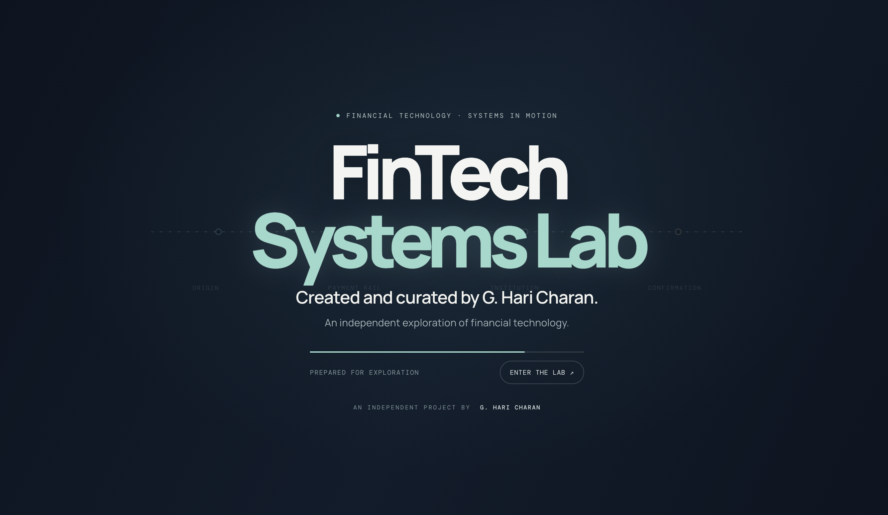
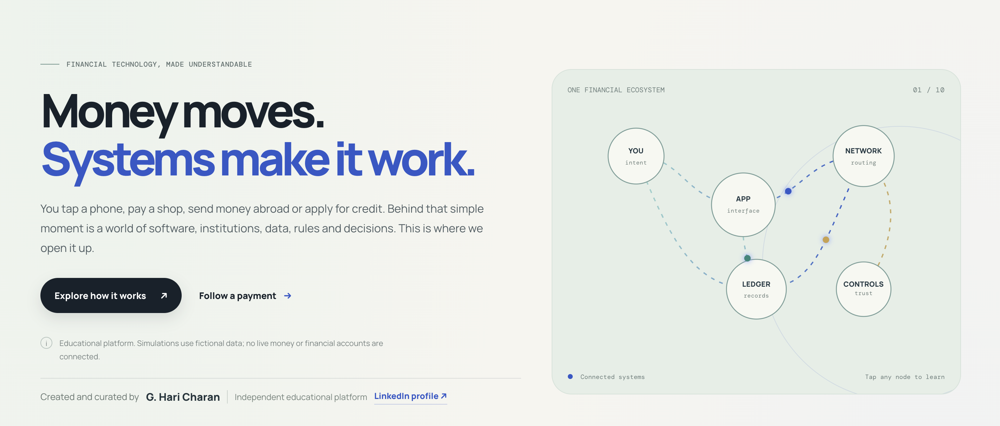
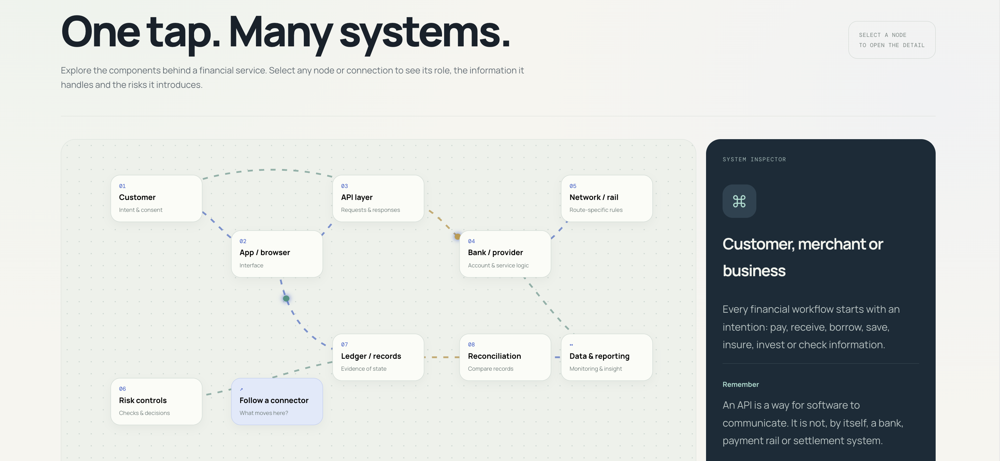
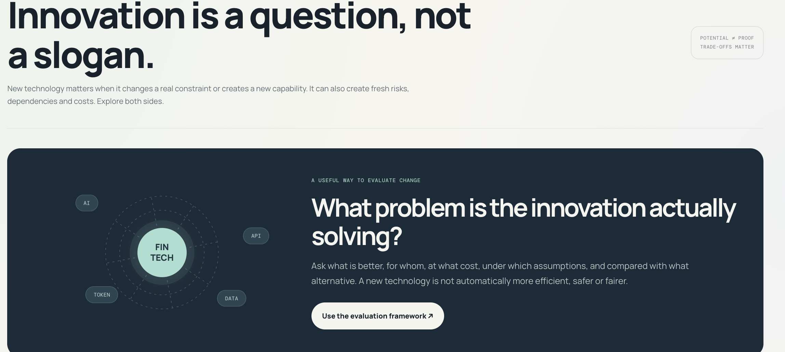
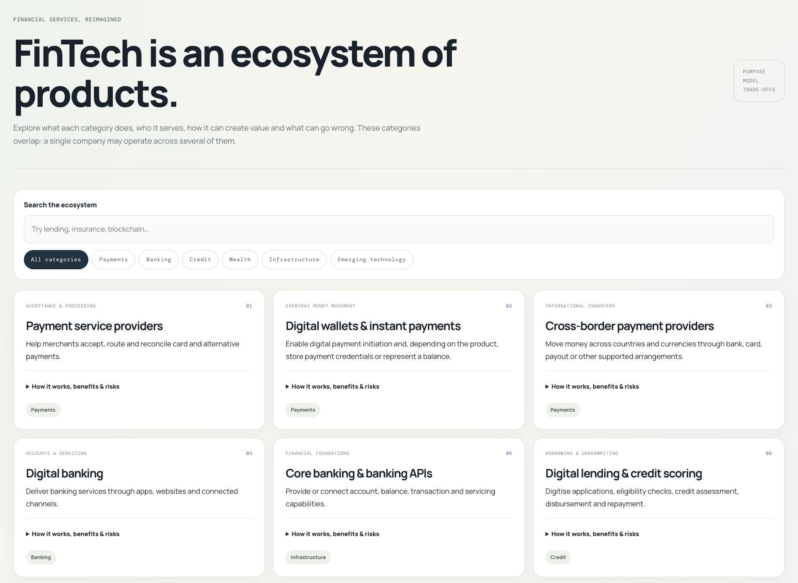
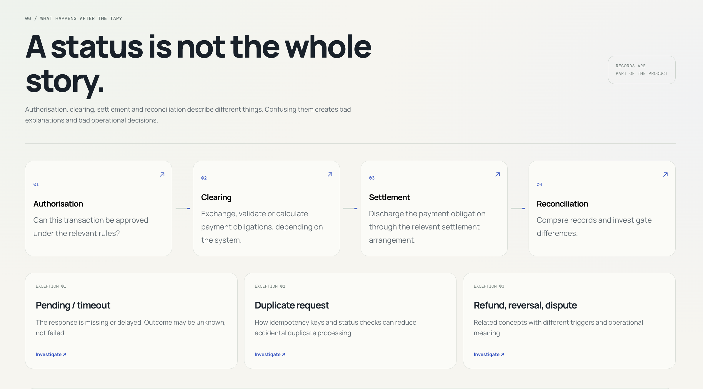
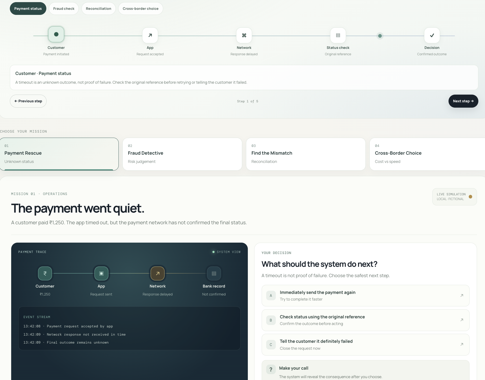
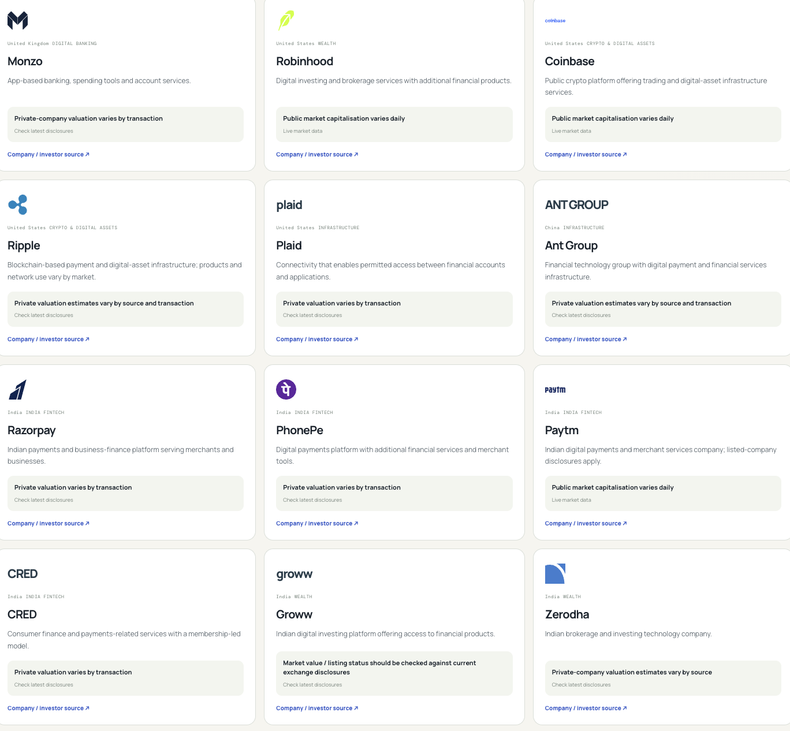
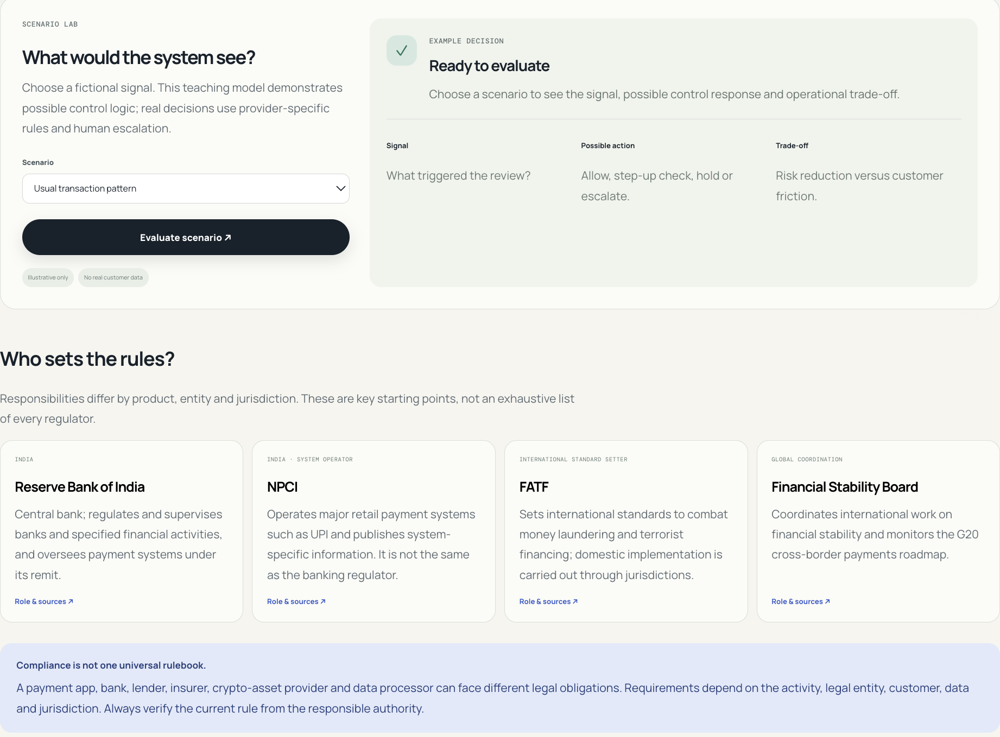
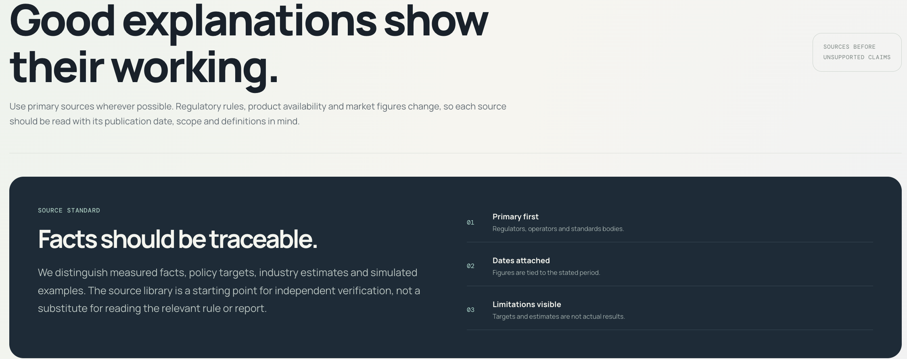

# FinTech Systems Lab

  

  <strong>An Interactive Exploration of Financial Technology and the Systems Behind It.</strong>

  <i>Understand the technology. Explore the mechanisms. Connect the systems.</i>

  <a href="https://urstrulyghc-5.github.io/fintech-systems-lab/"><strong>🌐 Enter FinTech Systems Lab →</strong></a>

  <i>Explore. Interact. Understand.</i>

---

## What Is FinTech Systems Lab?

  

**FinTech Systems Lab is an independently built interactive platform designed to explore how financial technology works, how its components connect, and how digital financial services operate behind the interface.**

Financial technology is more than an application, a payment button or a digital account.

Behind a seemingly simple transaction are interconnected systems involving users, financial institutions, software interfaces, APIs, payment networks, data, security controls, regulation and settlement mechanisms.

A payment may take seconds to initiate, yet its successful completion depends on multiple participants and processes working together.

The same principle extends to digital banking, lending, financial infrastructure, cross-border payments, regulatory technology and emerging financial innovations.

FinTech Systems Lab brings these relationships into one interactive environment.

The purpose is not simply to describe financial technology. It is to make its underlying mechanisms easier to explore, understand and experience.

> **The interface is what we see. The system behind it is what makes it work.**

---

## Why FinTech Systems Lab?

There is no shortage of information about financial technology. Product descriptions, technical explanations and industry terminology are readily available.

What is harder is understanding how the pieces work together.

What happens after a payment is initiated?

How do banks, payment networks and technology providers coordinate?

Why might a transaction require additional verification?

How does money move between institutions and across national borders?

What happens when a transaction fails, a risk signal appears or two systems cannot reconcile their records?

How do regulation, privacy and security influence the design of a financial product?

These questions shape the thinking behind FinTech Systems Lab.

The platform follows a progression:

**Concept → Architecture → Process → Interaction → Decision → Understanding**

The aim is to connect the visible experience of financial technology with the mechanisms that support it.

---

## The FinTech Landscape

FinTech brings together finance, technology, institutions and infrastructure.

The platform explores the relationships between these components through an interconnected view of the financial technology ecosystem.

| Domain | What it explores |
|---|---|
| Digital Payments | Payment initiation, routing, processing and confirmation |
| Digital Banking | Technology-enabled access to banking services |
| Lending Technology | Digital lending workflows and decision processes |
| WealthTech | Technology-enabled investment-related services |
| InsurTech | Digital insurance processes and service delivery |
| RegTech | Compliance, monitoring and reporting technology |
| Financial Infrastructure | The institutions, networks and systems supporting financial services |
| Cross-Border Payments | Mechanisms connecting financial institutions across countries |
| Emerging Innovations | Technologies that may change how financial services operate |

These domains do not exist in isolation.

A digital payment may involve a banking application, an API, a payment network, fraud controls and a settlement process.

A digital lending product may connect customer information, verification, assessment, financial institutions and repayment mechanisms.

**The connections are as important as the individual components.**

---

## Financial Technology Architecture

  

A financial technology product is supported by multiple layers.

The user-facing interface is only one part of the architecture. Behind it may be application services, APIs, databases, authentication systems, financial institutions, payment rails, risk controls and external service providers.

A simplified view of a financial technology workflow is:

**User Interface → Application Logic → APIs and Services → Financial Infrastructure → Processing and Settlement**

Security, monitoring, privacy and regulatory controls can operate across several layers rather than sitting in one isolated component.

The architecture differs according to the product, provider, jurisdiction and underlying infrastructure. Not every product uses the same sequence or technology.

This systems-oriented perspective helps explain why a successful financial product depends on more than an attractive interface.

> **A product experience is only as dependable as the systems supporting it.**

---

## FinTech Innovation

  

Innovation in financial technology is not limited to introducing new features.

It can involve reducing friction, improving accessibility, strengthening security, automating processes, connecting previously separate systems or making financial services more efficient.

FinTech Systems Lab explores innovation through the mechanisms and decisions that shape financial products.

Key areas include:

- Digital-first financial services.
- Real-time and account-to-account payments.
- API-driven connectivity.
- Automation and intelligent decision support.
- Fraud detection and transaction monitoring.
- Financial data management and privacy.
- Cross-border payment mechanisms.
- Emerging digital financial infrastructure.

Each innovation must be considered in context.

A faster process may introduce new operational dependencies. Greater connectivity may require stronger access controls. Automation may improve efficiency while creating new requirements for oversight and accountability.

**Innovation becomes meaningful when its benefits, dependencies and limitations are understood together.**

---

## FinTech Products

  

Financial technology becomes easier to understand when individual products are examined through their workflows.

The platform explores product categories through their underlying processes rather than treating each product as a standalone interface.

| Product category | Workflow perspective |
|---|---|
| Digital Banking | Account access, authentication and banking services |
| Payments | Initiation, verification, routing, processing and confirmation |
| Lending | Application, verification, assessment, decision and repayment |
| InsurTech | Policy-related processes, claims and service delivery |
| WealthTech | Digital investment-related services and account workflows |
| RegTech | Monitoring, compliance checks and reporting processes |
| Blockchain-Based Services | Distributed records, transaction validation and network coordination |

The precise workflow depends on the product and its implementation.

The objective is to understand how a product operates, which components participate, how information or instructions move, and where controls and dependencies matter.

Where interactive journeys are provided, users can explore the stages of a process and examine the role of its participants.

---

## From Transaction to Completion

  

A digital financial action often appears immediate to the user.

However, a transaction can pass through several stages before its final status is established.

A simplified payment journey may include:

**Initiation → Validation → Authentication → Routing → Processing → Settlement → Reconciliation**

Not every payment follows the same sequence. Some stages occur together, some happen asynchronously, and others depend on the payment method and participating institutions.

A transaction can also be declined, delayed, reversed or left pending while its status is resolved.

A successful response on a user interface does not necessarily mean that every downstream process has finished.

Understanding these distinctions helps explain the difference between a user action, transaction processing and final settlement.

FinTech Systems Lab uses process-oriented exploration to make these mechanisms easier to follow.

---

## Payments and Financial Connectivity

Payments demonstrate how multiple systems coordinate to deliver a financial service.

A payment journey can involve the payer, the payer's bank or payment service provider, payment infrastructure, the recipient's institution and the recipient.

The participants and sequence depend on the payment method.

### Payment categories

- **B2B:** Business-to-business payments.
- **B2C:** Business-to-consumer payments.
- **P2P:** Person-to-person payments.
- **C2B:** Consumer-to-business payments.

### Retail and wholesale payments

Retail payments commonly support everyday transactions between consumers, merchants and businesses.

Wholesale payments generally support larger-value transfers between financial institutions and other eligible participants, subject to the rules of the relevant payment system.

These categories serve different purposes and have different participants, operational requirements and settlement arrangements.

### Cross-border financial flows

Cross-border payments may involve multiple currencies, institutions, intermediaries, compliance checks and settlement arrangements.

Different mechanisms can produce different costs, processing times, transparency and operational dependencies.

Understanding these differences requires examining the route, the participating institutions and the mechanisms used to transfer value.

The platform explores these relationships to show that moving money between parties is not one universal process.

> **A payment is not merely an instruction to transfer money. It is a coordinated process governed by the systems through which it travels.**

---

## Interactive Playground

  

The Interactive Playground brings financial technology concepts into an environment where users can explore decisions, follow process stages and observe outcomes.

Instead of only reading an explanation, users can engage with guided journeys and examine how different choices influence a simulated process.

Learning scenarios may include:

- Following a payment through its processing stages.
- Exploring authentication and verification decisions.
- Understanding why a transaction may be approved, declined or held for review.
- Examining fraud-related checks and risk signals.
- Exploring reconciliation and transaction-status differences.
- Comparing simplified cross-border payment mechanisms.
- Understanding how operational decisions affect a workflow.

Where a scenario uses simulated values or constructed examples, those should be understood as educational illustrations rather than representations of a live financial system.

The objective is to develop a clearer understanding of the decisions, dependencies and consequences involved in financial technology.

**Interaction should make the mechanism clearer, not simply make the screen more entertaining.**

---

## FinTech Pioneers and Influential Contributors

  

Financial technology has developed through contributions from banking, computing, telecommunications, cryptography, payments, regulation and software engineering.

Its evolution cannot be attributed to a single invention or individual.

The systems used today build upon decades of institutional development, technical advances, financial innovation and collaboration across industries.

Exploring influential contributors and milestones provides historical context for understanding how financial services moved from traditional processes towards increasingly connected digital systems.

The emphasis is on understanding the ideas, innovations and developments that helped shape the present financial technology ecosystem.

---

## Rules, Regulation and Safeguards

  

Financial technology operates within legal, regulatory and operational boundaries.

Innovation must be considered alongside consumer protection, data privacy, cybersecurity, fraud prevention, financial crime controls and the responsibilities of participating institutions.

Important questions include:

- How should sensitive financial information be protected?
- How do authentication and access controls reduce unauthorised activity?
- Why are fraud monitoring and transaction controls necessary?
- How do regulatory requirements influence product design?
- What happens when a transaction raises a compliance concern?
- How should financial services balance convenience, security and accountability?

Requirements differ across countries, financial products and types of service providers.

The platform aims to explain the purpose of relevant controls and their role in financial technology systems. It is not a substitute for current legislation, regulatory directions or professional legal advice.

> **Trust in financial technology depends on more than convenience. It also depends on safeguards, accountability and responsible system design.**

---

## Understanding the Benefits and Limitations

Financial technology can improve accessibility, convenience, processing efficiency and connectivity. It can also introduce operational dependencies and new forms of risk.

A balanced understanding considers both sides.

| Potential benefits | Potential challenges |
|---|---|
| Faster digital experiences | System outages and service disruption |
| Greater access to financial services | Unequal access to devices or connectivity |
| Automated workflows | Errors and unintended automated outcomes |
| Connected financial systems | Third-party and integration dependencies |
| Digital records and monitoring | Data privacy and cybersecurity risks |
| New financial products | Consumer protection and regulatory challenges |
| Cross-border connectivity | Currency, compliance and settlement complexity |

The outcome depends on how a product is designed, implemented, governed and used.

FinTech Systems Lab encourages the examination of mechanisms and trade-offs rather than assuming that every new technology is automatically better.

---

## References and Sources

  

Financial technology is a field where technical details, regulatory requirements and industry practices can change.

Reliable understanding therefore requires more than a well-presented explanation.

Where applicable, research should draw on authoritative materials such as:

- Central banks and financial regulators.
- Payment system operators and infrastructure providers.
- Official technical documentation.
- Standards organisations.
- Academic research and established publications.
- Official reports and institutional publications.

Sources should support the specific claims for which they are cited. Historical facts, technical explanations and regulatory statements should be distinguished from interpretation, simplified examples and forward-looking observations.

Where a process is simplified for educational purposes, that limitation should be made clear.

**Clarity matters. Evidence matters. Context matters.**

---

## The FinTech Systems Lab Journey

The platform brings its subject matter together through a progression from foundational ideas to practical system exploration.

| Stage | Purpose |
|---|---|
| **Introduction** | Understand the purpose and scope of financial technology |
| **Innovation** | Explore the ideas changing financial services |
| **Architecture** | Examine the layers and components behind products |
| **Products** | Understand financial technology categories |
| **Processes** | Follow the stages that make services work |
| **Payments and Flows** | Explore participants, routes and transaction mechanisms |
| **Playground** | Practise through guided interactive scenarios |
| **Pioneers** | Discover the developments that shaped the field |
| **Rules and Safeguards** | Understand regulation, security and responsibility |
| **References** | Trace information to supporting sources |

The journey connects concepts with mechanisms, mechanisms with decisions, and decisions with their potential consequences.

The platform is intended to help users ask better questions about the financial services they use, study or build.

---

## What FinTech Systems Lab Stands For

The platform is built around a few principles.

| Principle | Approach |
|---|---|
| **Understanding** | Explain how systems work, not only what they are called |
| **Connectivity** | Show relationships between participants and components |
| **Interaction** | Use meaningful exploration to support learning |
| **Clarity** | Make complex mechanisms easier to follow |
| **Accuracy** | Distinguish established facts from simplifications and assumptions |
| **Responsibility** | Recognise the importance of privacy, security and regulation |
| **Practicality** | Connect concepts with workflows and decisions |
| **Purpose** | Ensure that design and animation contribute to understanding |

Animations should explain movement or sequence.

Interactive controls should reveal meaningful choices.

Simulations should make assumptions and outcomes understandable.

References should help readers verify important information.

Design should support the substance of the experience.

**Every element should have a reason to exist.**

---

## The Thinking Behind the Platform

FinTech Systems Lab grew from a desire to explore financial technology beyond its visible interface.

The central question was not simply how to describe a digital financial product, but how to make its underlying systems easier to understand.

That meant examining the relationships between financial institutions, software, payment infrastructure, data, processes, risk and regulation.

It also meant exploring how these components behave when a transaction moves through a system, a decision is required or a process encounters a problem.

The platform brings those questions into an interactive environment through research, structured explanations, visual design and experimentation.

It is a continuing effort to improve how financial technology can be explored and understood.

---

## About G Hari Charan

**FinTech Systems Lab was conceived and developed by G Hari Charan as an independent project exploring financial technology, financial systems and interactive learning.**

The platform reflects an interest in understanding how financial services work beneath the surface and how complex mechanisms can be presented in a clear, accessible form.

Its development brings together research, financial concepts, systems thinking, interface design and experimentation with interactive experiences.

The intention is to make financial technology easier to explore without overlooking the complexity, dependencies and responsibilities behind it.

FinTech Systems Lab is an independent educational project. It does not represent a financial institution, payment network or regulatory authority.

The platform does not replace professional financial, legal, cybersecurity or regulatory advice. Interactive scenarios should be treated as educational experiences unless explicitly stated otherwise.

  <a href="https://www.linkedin.com/in/gharicharan/"><strong>Connect with G Hari Charan on LinkedIn →</strong></a>

---

  <strong>FinTech Systems Lab</strong>

  An interactive exploration of the technology, processes and systems behind modern financial services.

  <i>Built by G Hari Charan.</i>

